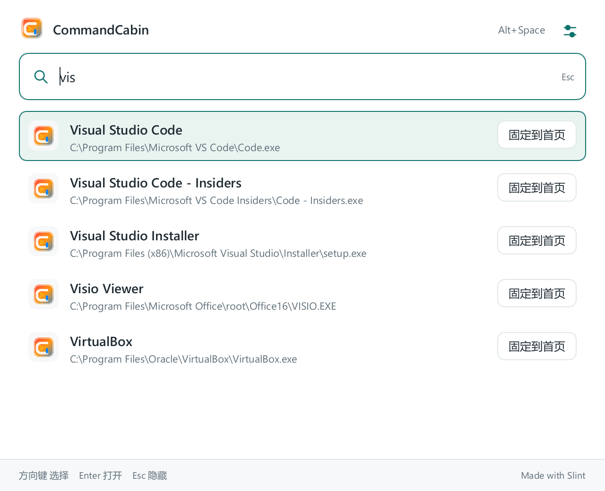

# CommandCabin

<p align="center">
  
</p>

<h1 align="center">CommandCabin</h1>

<p align="center">
  <strong>A native, keyboard-first command console for Windows.</strong>
  <br />
  One fast entry point for apps, screenshots, unit and currency conversion, clipboard history and text tools.
</p>

<p align="center">
  <a href="https://github.com/RupingLiu/command-cabin/releases">
    
  </a>
  
  
  
  
</p>

<p align="center">
  <a href="./README.md">中文 README</a>
  ·
  <a href="#screenshots">Screenshots</a>
  ·
  <a href="#features">Features</a>
  ·
  <a href="#installation">Installation</a>
  ·
  <a href="#architecture">Architecture</a>
  ·
  <a href="#development">Development</a>
  ·
  <a href="#versioning">Versioning</a>
</p>

## Screenshots

<p align="center">
  
</p>

<p align="center"><sub>Home with an empty query: pinned app grid, home actions and recently used items</sub></p>

<p align="center">
  
</p>

<p align="center"><sub>Typing switches to search results: arrow keys to move, Enter to run</sub></p>

The launcher uses a soft warm-to-blue gradient, rendered natively by Slint with no browser engine involved.

## What it is

CommandCabin is a lightweight, fast, local-first productivity tool for Windows. It pulls app launching, screenshot annotation, OCR text extraction, translation, unit and currency conversion, clipboard history and text processing into a single keyboard-friendly entry point.

Since v1.0.0 the product has been migrated from Electron to a **native Rust + Slint implementation**: a single executable with no runtime dependency, low resident memory, and an installer around 6 MB.

It is not meant to become a heavy workflow platform. The goal is a responsive, quiet, always-available desktop console.

| Principle      | Description                                                                                  |
| -------------- | -------------------------------------------------------------------------------------------- |
| Local-first    | Settings, history, favorites, index and clipboard data live in a local SQLite database.       |
| Keyboard-first | Wake it with a global hotkey, type to search, use arrow keys to select, press Enter to run.   |
| Native & light | Compiled to a native binary with Rust + Slint, no Electron and no bundled browser engine.     |
| Windows-first  | Focused on Windows desktop behavior: shortcut resolution, tray, installation and auto-update. |
| Crafted for use | Search speed, icon resolution, screenshot feel, language, theme and window behavior are tuned. |

## Features

| Feature               | Description                                                                                                                          |
| --------------------- | ------------------------------------------------------------------------------------------------------------------------------------ |
| Quick launcher        | Default `Alt+Space`; the hotkey is configurable in Settings.                                                                         |
| App search            | Scans Start Menu, desktop shortcuts and common install locations (including MSIX/APPX apps) with fuzzy matching and ranked ordering. |
| Home shortcuts        | An empty query shows the pinned app grid, screenshot and unit-converter entries, plus recently used items.                           |
| Icon resolution       | Resolves real executable icons, falling back to shortcuts, AppUserModelID, associated files and an on-disk cache.                    |
| Screenshot tool       | Default `Ctrl+Alt+A`; delayed capture on `Ctrl+Alt+D`. Rectangle, ellipse, arrow, pen, mosaic and text annotations.                   |
| Screenshot follow-ups | In-region OCR, online translation, pin-on-top, copy to clipboard and save as PNG.                                                    |
| Unit conversion       | Dedicated page covering weight (kg/g/mg/lb/oz) and length (m/cm/mm/in/ft) with swappable units.                                       |
| Currency conversion   | Built-in USD→CNY rate lookup and conversion, showing the rate's data date.                                                           |
| Clipboard history     | Records copied text, searchable and invokable from the unified result list; can be cleared.                                          |
| Built-in commands     | Calculator, text tools (case conversion, remove blank lines, format JSON, URL encode/decode) and quick conversion, as search commands. |
| System tray           | Closing the window keeps the app running in the tray; the tray menu follows the UI language.                                          |
| Launch at login       | Optional auto-start after sign-in, and it can start hidden.                                                                          |
| Version & updates     | Checks GitHub Releases, downloads the installer in the background with SHA512 verification, then prompts to restart and install.       |
| Languages & themes    | Simplified Chinese, Traditional Chinese and English; light, dark and follow-system themes.                                            |

## Installation

Download the latest Windows x64 installer from [GitHub Releases](https://github.com/RupingLiu/command-cabin/releases).

Release assets follow a fixed naming scheme:

- `CommandCabin-Setup-{version}.exe`
- `CommandCabin-Setup-{version}.exe.sha512` (checksum file)

Notes:

- The install directory can be chosen during setup.
- Setup creates a desktop shortcut and a Start Menu entry.
- Installed builds can check for updates from Settings, and also check automatically after startup.

> The installer is not code-signed, so Windows SmartScreen may ask you to confirm. Use the `.sha512` file next to it to verify download integrity.

Common actions:

| Action                | How                                              |
| --------------------- | ------------------------------------------------ |
| Open the launcher     | Default `Alt+Space`                              |
| Run the selected item | `Enter`                                          |
| Move the selection    | `Up` / `Down` / `Left` / `Right`                 |
| Close the launcher    | `Esc`                                            |
| Pin an app            | "Pin to home" in the result row                  |
| Unpin an app          | Right-click a pinned tile                        |
| Open unit conversion  | The unit converter entry on the home screen      |
| Quick screenshot      | Default `Ctrl+Alt+A`                             |
| Delayed screenshot    | Default `Ctrl+Alt+D`                             |
| Open settings         | The gear icon in the title bar, or the tray menu |
| Hide to tray          | Close the window or use the tray menu            |

## Architecture

The native Cargo workspace lives in `native/` and is split by responsibility:

```text
native/
├─ crates/
│  ├─ cabin-core/              Pure business logic: command model, search ranking, settings,
│  │                           indexing, screenshot state, unit conversion, currency rates,
│  │                           clipboard history, updater protocol and parsing
│  ├─ cabin-storage/           SQLite persistence and migrations
│  ├─ cabin-platform/          Platform abstraction traits (hotkeys, tray, clipboard, OCR, update service)
│  ├─ cabin-platform-windows/  Windows implementation (Win32, COM, WinRT)
│  └─ cabin-app/               App shell: Slint UI orchestration, windows, event loop
├─ ui/                         Slint UI definitions (launcher, settings, screenshot, converter, pin window)
├─ assets/                     Icons and font resources
└─ scripts/                    Build, test and packaging scripts
```

Layering rules: `cabin-core`, `cabin-storage` and `cabin-platform` do not depend on Windows or a UI framework. Platform differences are captured by traits in `cabin-platform` and implemented in `cabin-platform-windows`. `cabin-app` is the only crate that touches Slint, winit or Win32.

| Layer     | Technology                                                     |
| --------- | -------------------------------------------------------------- |
| Language  | Rust (stable, GNU toolchain)                                   |
| UI        | Slint 1.x (software renderer, no persistent GPU overhead)      |
| Storage   | SQLite (`rusqlite`, bundled)                                   |
| System    | Win32 / COM / WinRT (hotkeys, tray, OCR, Shell, packaged apps) |
| HTTP      | `ureq` + rustls (currency rates, translation, update checks)   |
| Packaging | NSIS (`makensis`)                                              |
| Testing   | `cargo test` (unit tests live next to the source)              |

## Development

Run these from the `native/` directory. The toolchain is not on the default PATH, so bootstrap it first:

```powershell
$env:PATH = "$env:USERPROFILE\.cargo\bin;C:\msys64\ucrt64\bin;$env:PATH"
```

Build (the script clears `native/target` afterwards and copies the executable to `native/artifacts/`):

```powershell
powershell native/scripts/build.ps1
```

Release build:

```powershell
powershell native/scripts/build.ps1 -Release
```

Tests:

```powershell
powershell native/scripts/build.ps1 -Test
# or target a single crate
cargo test -p cabin-core
```

Lint and format:

```powershell
cargo clippy --workspace -- -D warnings
cargo fmt
```

Build the Windows installer (produces `CommandCabin-Setup-{version}.exe` and `.sha512`):

```powershell
powershell native/scripts/build-installer.ps1
```

The single source of version is `[workspace.package] version` in `native/Cargo.toml`.

## Conventions

- Platform-specific capabilities are reached through `cabin-platform` traits; the core never calls Win32 directly.
- Tests live next to the source as `#[cfg(test)]` modules; pure logic belongs in `cabin-core`.
- Boundary parsing stays strict: unknown or malformed input is rejected before it reaches core logic.
- Changes touching persistence, the updater, packaging or shared core contracts need broader tests.
- Live-network probes are marked `#[ignore]` and must be run explicitly.

## Versioning

CommandCabin uses a strict `x.y.z` version scheme:

| Part | Meaning                                                                                         |
| ---- | ----------------------------------------------------------------------------------------------- |
| `x`  | Major architecture changes, or breaking changes in product direction.                             |
| `y`  | User-visible additions, such as new tools, entry points, analysis capabilities or UI features.    |
| `z`  | Bug fixes, protocol corrections, copy or experience polish, test hardening, with no new features. |

See [docs/product/versioning-policy.md](./docs/product/versioning-policy.md) for details.

## History

`apps/desktop` (Electron + React) and `packages/*` are the host implementation used before v1.0. Since v1.0.0 the product has shipped as the native build; that code is kept only as a behavioral reference and is no longer distributed in releases.

## Further reading

- [Release checklist](./docs/superpowers/acceptance/m5-release.md)
- [Windows packaging workflow](./docs/product/windows-packaging-workflow.md)
- [Design and verification records](./docs/superpowers/specs)

## License

Released under the MIT License. See [LICENSE](./LICENSE) for details.
