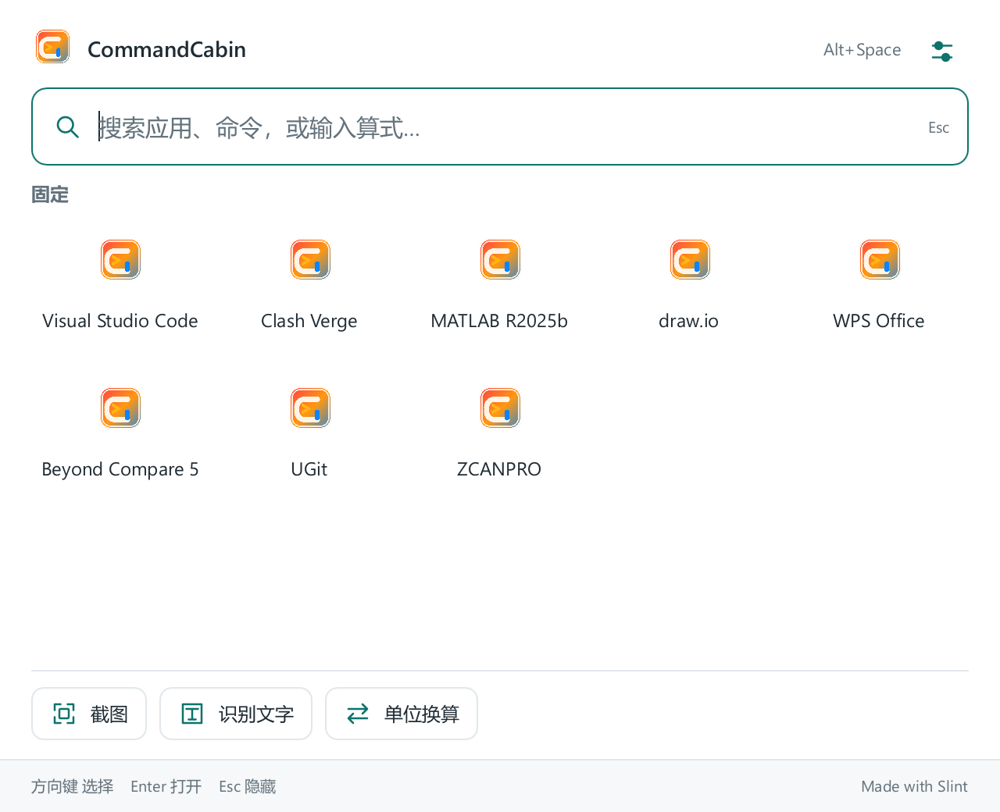

# CommandCabin

<p align="center">
  
</p>

<h1 align="center">CommandCabin</h1>

<p align="center">
  <strong>Windows 优先的原生桌面命令中枢。</strong>
  <br />
  用一个快速入口连接应用、截图、换算、汇率、剪贴板和文本工具。
</p>

<p align="center">
  <a href="https://github.com/RupingLiu/command-cabin/releases">
    
  </a>
  
  
  
  
</p>

<p align="center">
  <a href="#界面预览">界面预览</a>
  ·
  <a href="#核心能力">核心能力</a>
  ·
  <a href="#安装使用">安装使用</a>
  ·
  <a href="#技术架构">技术架构</a>
  ·
  <a href="#开发">开发</a>
  ·
  <a href="#版本策略">版本策略</a>
</p>

## 界面预览

<p align="center">
  
</p>

启动器采用暖色到蓝色的轻量渐变视觉。空查询时展示固定应用网格、「首页功能」入口和最近使用；输入即切换到搜索结果，方向键选择、回车执行。

## 产品定位

CommandCabin 是一款轻量、快速、本地优先的 Windows 桌面效率工具。它把应用启动、截图标注、OCR 取字、翻译、单位与汇率换算、剪贴板历史和文本处理收拢到一个键盘友好的入口里。

它从 v1.0.0 起已由 Electron 迁移为 **Rust + Slint 原生实现**：单文件可执行、无运行时依赖、常驻内存低，安装包约 6MB。

它的目标不是变成复杂工作流平台，而是做一个反应灵敏、安静可靠、随时可唤起的桌面控制台。

| 原则         | 说明                                                             |
| ------------ | ---------------------------------------------------------------- |
| 本地优先     | 设置、历史、收藏、索引和剪贴板数据保存在本机 SQLite，不上传云端。 |
| 键盘友好     | 全局快捷键唤起，输入搜索，方向键选择，回车执行。                 |
| 原生轻量     | Rust + Slint 编译为原生二进制，无 Electron / 浏览器内核。        |
| Windows 优先 | 聚焦 Windows 桌面体验、快捷方式解析、托盘、安装和自动更新。      |
| 体验优先     | 搜索速度、图标解析、截图手感、语言、主题和窗口行为按真实场景打磨。 |

## 核心能力

| 能力         | 说明                                                                                       |
| ------------ | ------------------------------------------------------------------------------------------ |
| 快速唤起     | 默认 `Alt+Space` 呼出启动器，快捷键可在设置中修改。                                        |
| 应用搜索     | 扫描开始菜单、桌面快捷方式与常见安装位置（含 MSIX/APPX 应用），支持模糊匹配与多因子排序。   |
| 首页常用入口 | 空查询时展示固定应用网格、截图与单位换算入口，以及最近使用记录。                           |
| 图标解析     | 解析真实可执行文件图标，对快捷方式、AppUserModelID、关联文件与磁盘缓存做兜底。              |
| 截图工具     | 默认 `Ctrl+Alt+A`；延时截图为 `Ctrl+Alt+D`。支持矩形、椭圆、箭头、画笔、马赛克和文字标注。   |
| 截图后处理   | 区域内 OCR 取字、在线翻译、贴图置顶、复制到剪贴板和保存为 PNG。                             |
| 单位换算     | 独立换算页，覆盖重量（kg/g/mg/lb/oz）与长度（m/cm/mm/in/ft），单位可互换。                  |
| 汇率换算     | 内置 USD→CNY 汇率查询与换算，结果附数据日期。                                              |
| 剪贴板历史   | 记录复制的文本内容，可从搜索结果统一检索与调用，支持清空。                                 |
| 内置命令     | 计算器、文本工具（大小写转换、去空行、格式化 JSON、URL 编解码）、快速换算等以命令进入搜索。 |
| 系统托盘     | 关闭窗口后隐藏到托盘继续运行，托盘菜单跟随界面语言。                                       |
| 开机自启动   | 设置中开启登录后自动启动，可配合启动时隐藏窗口。                                           |
| 版本与更新   | 从 GitHub Releases 检查更新、后台下载安装包并做 SHA512 校验，完成后提示重启安装。           |
| 多语言与主题 | 简体中文、繁体中文、英文；主题支持浅色、深色与跟随系统。                                   |

## 安装使用

最新 Windows x64 安装包可在 [GitHub Releases](https://github.com/RupingLiu/command-cabin/releases) 下载。

资产命名固定：

- `CommandCabin-Setup-{version}.exe`
- `CommandCabin-Setup-{version}.exe.sha512`（校验文件）

安装信息：

- 安装时可选择安装路径。
- 安装后创建桌面快捷方式与开始菜单入口。
- 已安装版本可在设置页手动检查更新，启动后也会自动检查。

> 安装包未签名，Windows SmartScreen 可能提示确认运行。可用同名 `.sha512` 校验文件核对下载完整性。

常用操作：

| 操作         | 方式                                 |
| ------------ | ------------------------------------ |
| 打开启动器   | 默认 `Alt+Space`                     |
| 执行选中命令 | `Enter`                              |
| 移动选中项   | `Up` / `Down` / `Left` / `Right`     |
| 关闭启动器   | `Esc`                                |
| 固定应用     | 搜索结果行内「固定到首页」           |
| 取消固定     | 右键固定卡片                         |
| 打开单位换算 | 首页「单位换算」入口                 |
| 快速截图     | 默认 `Ctrl+Alt+A`                    |
| 延时截图     | 默认 `Ctrl+Alt+D`                    |
| 打开设置     | 标题栏齿轮图标或托盘菜单             |
| 隐藏到托盘   | 关闭窗口或使用托盘菜单               |

## 技术架构

原生 Cargo 工作区位于 `native/`，按职责分层：

```text
native/
├─ crates/
│  ├─ cabin-core/              纯业务逻辑：命令模型、搜索排序、设置、索引、截图状态、
│  │                           单位换算、汇率、剪贴板历史、更新器协议与解析
│  ├─ cabin-storage/           SQLite 持久化与迁移
│  ├─ cabin-platform/          平台抽象 trait（热键、托盘、剪贴板、OCR、更新服务等）
│  ├─ cabin-platform-windows/  Windows 实现（Win32、COM、WinRT）
│  └─ cabin-app/               应用壳：Slint UI 编排、窗口、事件循环
├─ ui/                         Slint 界面定义（启动器、设置、截图、换算、置顶图窗）
├─ assets/                     图标与字体资源
└─ scripts/                    构建、测试与安装包脚本
```

分层规则：`cabin-core` / `cabin-storage` / `cabin-platform` 不依赖 Windows 或 UI 框架；平台差异经 `cabin-platform` 的 trait 收敛，由 `cabin-platform-windows` 实现；`cabin-app` 是唯一接触 Slint / winit / Win32 的 crate。

| 层级     | 技术                                                  |
| -------- | ----------------------------------------------------- |
| 语言     | Rust（stable，GNU 工具链）                            |
| 界面     | Slint 1.x（软件渲染后端，无 GPU 常驻开销）            |
| 存储     | SQLite（`rusqlite`，bundled）                          |
| 系统集成 | Win32 / COM / WinRT（热键、托盘、OCR、Shell、打包应用） |
| HTTP     | `ureq` + rustls（汇率、翻译、更新检查）               |
| 打包     | NSIS（`makensis`）                                    |
| 测试     | `cargo test`（单元测试与源文件同目录）                |

## 开发

以下命令在 `native/` 目录执行。工具链需先自举 PATH：

```powershell
$env:PATH = "$env:USERPROFILE\.cargo\bin;C:\msys64\ucrt64\bin;$env:PATH"
```

构建（构建后自动清理 `native/target`，产物复制到 `native/artifacts/`）：

```powershell
powershell native/scripts/build.ps1
```

Release 构建：

```powershell
powershell native/scripts/build.ps1 -Release
```

测试：

```powershell
powershell native/scripts/build.ps1 -Test
# 或定向跑单包
cargo test -p cabin-core
```

静态检查与格式化：

```powershell
cargo clippy --workspace -- -D warnings
cargo fmt
```

生成 Windows 安装包（产出 `CommandCabin-Setup-{version}.exe` 与 `.sha512`）：

```powershell
powershell native/scripts/build-installer.ps1
```

版本单一来源是 `native/Cargo.toml` 的 `[workspace.package] version`。

## 开发约定

- 平台相关能力必须经 `cabin-platform` 的 trait 引入，不在核心层直接调用 Win32。
- 测试与源文件同目录（`#[cfg(test)]` 模块），纯逻辑优先下沉到 `cabin-core`。
- 边界解析保持严格：未知或畸形输入在进入核心逻辑前拒绝。
- 触及 IPC、持久化、更新器、打包或共享核心契约时，需要配套更充分的测试。
- 真机外网探针以 `#[ignore]` 标记，需显式运行。

## 版本策略

CommandCabin 使用严格的 `x.y.z` 版本号：

| 段位 | 含义                                                                 |
| ---- | -------------------------------------------------------------------- |
| `x`  | 重大架构变更，或产品方向上的破坏性调整。                             |
| `y`  | 用户可见的功能新增，例如新工具、新入口、新分析能力或界面功能。       |
| `z`  | Bug 修复、协议规则修正、文案或体验优化、测试补强等不新增功能的改动。 |

详细规则见 [docs/product/versioning-policy.md](./docs/product/versioning-policy.md)。

## 历史

`apps/desktop`（Electron + React）与 `packages/*` 是 v1.0 之前的宿主实现，v1.0.0 起产品已切换为原生版本，这部分代码仅作行为参照保留，不再随 Release 分发。

## 更多文档

- [发布检查清单](./docs/superpowers/acceptance/m5-release.md)
- [Windows 打包流程](./docs/product/windows-packaging-workflow.md)
- [设计与验证记录](./docs/superpowers/specs)

## 许可证

本项目基于 MIT 许可证开源。详见 [LICENSE](./LICENSE)。
